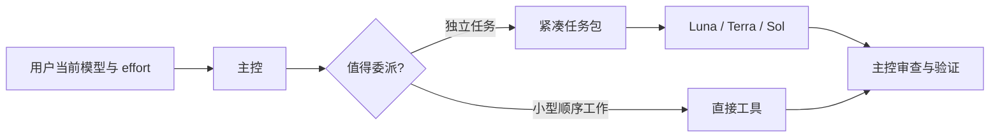

# Agent Strata

面向 Codex 和 Claude Code 的原生子 Agent 编排 skill。目标是降低合格开发成果的总成本和耗时：按任务选择模型与推理强度，隔离噪声上下文，保留必要验证。

Codex 主控始终跟随用户在 CLI/App 中的当前模型和推理强度，后续切换也优先。GPT-6.1 Sol `xhigh` 是个人使用建议，安装器不会写入或恢复主控配置。Strata 不设子 Agent 数量上限；主控按真实宿主槽位、独立任务、资源、成本和整合能力决定并发，默认一个写入者。

## 当前 GPT 分工

路由更新于 2026-11-12。按同类任务的验收结果、重试、耗时和总费用调整。

| 模型 | 建议任务 | 子任务推理强度 |
|---|---|---|
| GPT-6.1 Terra `gpt-6.1-terra` | 普通功能、修复、重构、测试，以及有明确验收的写作和视觉任务 | `worker` 默认 `medium`，较难的有界任务用 `high` |
| GPT-6 Luna `gpt-6-luna` | 独立代码定位、日志取证、摘要和机械操作 | `scout`、`executor` 默认 `medium`，简单任务用 `low` |
| GPT-6.1 Sol `gpt-6.1-sol` | 跨模块根因、复杂实现和关键审查 | `deep_worker`、`reviewer` 用 `high/xhigh` |
| GPT-6 Astra `gpt-6-astra` | 跨代码、浏览器与专业软件的高难度长流程评估 | 显式选择，不自动回退 |

[官方 Standard 短上下文 API 定价](https://developers.openai.com/api/docs/pricing)，单位为美元 / 百万 token：

| 模型 | 输入 | 缓存读取 | 输出 |
|---|---:|---:|---:|
| Sol 6.1 | 2 | 0.10 | 10 |
| Terra 6.1 | 1 | 0.05 | 5 |
| Luna 6 | 0.10 | 0.01 | 0.50 |
| Astra 6 | 10 | 1 | 50 |

Artificial Analysis 的同档评测中，Terra medium 平均每任务花费 $0.17，耗时 2.7 分钟。Sol medium 为 $0.36 和 4.2 分钟。Strata 据此把 Terra medium 作为普通编码的起点，以实际测试和返工决定是否升级。 [Artificial Analysis 同档对照](https://artificialanalysis.ai/models/comparisons/gpt-6-1-terra-medium-vs-gpt-6-1-sol-medium)

完整的输入 / 输出价格、任务耗时、成本、智能、速度、延迟和上下文窗口见 [成本与质量依据](skills/strata/references/cost-control.md)。API 最大窗口不等于 Codex 当前可用窗口；订阅额度、API 美元和第三方网关费用分别核算。

## 编排与上下文

多步任务优先找一项可独立验收的工作交给子 Agent，例如实现一个范围明确的修复，或在主控实现期间定位现有测试。小型顺序工作直接用工具。任务包写明文件、契约、可写路径、验收和停止条件。子 Agent 返回结论、位置、测试和不确定性。



不复制整段聊天给每个子 Agent，不重复搜索同一个问题；复用证据，按需读引用。默认一个写入者，多写入者必须路径互不重叠、共享契约固定、每个域可独立验证。超过宿主容量的任务排队。子 Agent 不派生、不自行提交 / 推送 / 部署，也不跨厂商调用。[详细编排规则](docs/orchestration.md)。

## 安装并跟踪 main

推荐维护一个 `main` checkout，把已发现的 skill 目录链接到其中的 `skills/strata`。先检查并备份已有安装，再建立链接：

```bash
git clone --branch main https://github.com/SanStone3/agent-strata.git /path/to/agent-strata
ln -s /path/to/agent-strata/skills/strata /path/to/discovered-skills/strata
```

同机项目共用技能源，各 CLI/App/SSH 登录仍保留自己的 CODEX_HOME、Agent 定义和绑定。链接跟随本地 checkout；远端更新需要在维护时 `fetch` 后 `merge --ff-only origin/main`，不自动重置有改动的目录，也不安装后台更新器。

快照安装可用：

```bash
npx -y skills@1.5.23 add SanStone3/agent-strata -g -a codex -s strata -y
```

安装 skill 后，由 AI 检查实际客户端，备份并增量合并角色定义与规则；保持主控、认证、provider、权限和其他设置。原生工具支持覆盖模型时直接按任务选择；仅支持命名角色的客户端需要生成绑定并验证重载。参见 [安装与作用域](docs/installation.md)。Claude 保留自己的原生模型策略，不随本次 Codex 优化改动。

## 解析与验证

```bash
# 使用当前工具目录，或 --discover 发现匹配客户端的目录。
python3 skills/strata/scripts/resolve_models.py --catalog /path/to/models.json
python3 skills/strata/scripts/resolve_models.py --catalog /path/to/models.json \
  --effort worker=high --role worker
python3 skills/strata/scripts/resolve_models.py --catalog /path/to/models.json \
  --output-dir /path/to/new-staging-dir

python3 skills/strata/scripts/validate.py --repo .
python3 -m unittest discover -s tests -v
```

解析器默认生成子 Agent 配置。普通 `worker` 优先 Terra medium，Sol 作为符合条件的同档回退。`--pin ROLE=MODEL` 指定模型，`--effort ROLE=LEVEL` 指定角色与模型都支持的强度。旧的 `--task-kind coding` 和 `--task-kind scoped` 参数共用同一套普通 `worker` 策略。

结构校验与目录发现不证明实际推理权限或任务质量。必要时通过已授权的原生任务核验，不因安装额外运行付费基准。详见 [模型路由](skills/strata/references/model-routing.md)、[验证等级](skills/strata/references/validation.md) 和 [独立登录 / SSH](skills/strata/references/auth-context.md)。

## 仓库内容

`skills/strata/SKILL.md` 为短入口；`references/` 按需加载；`assets/` 保存模型策略和 Codex / Claude 模板；`scripts/` 负责只读发现、解析、暂存生成与校验；`tests/` 覆盖路由和配置回归。模型数据是注明日期的参考，实际验收反馈优先；不承诺固定节省百分比。

[MIT License](LICENSE)
